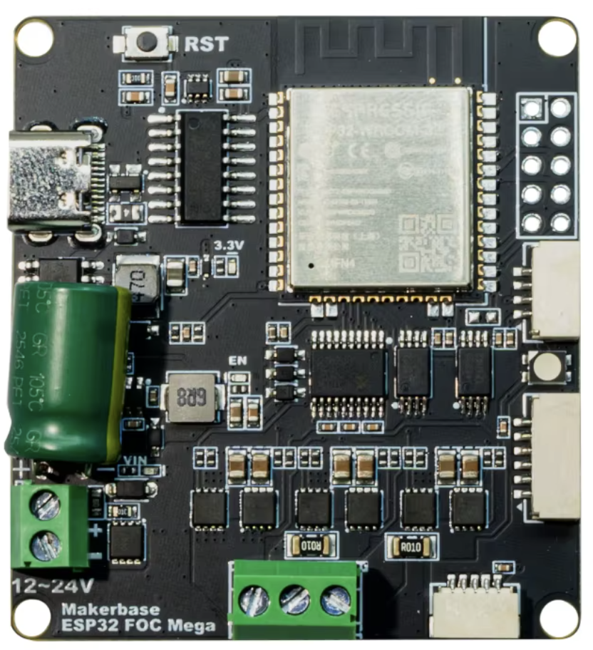

DOI: [10.5281/zenodo.20809345](https://doi.org/10.5281/zenodo.20809345)

# Parallel Mirror Steer-by-Wire

An open-source research platform for bilateral embodied human–robot interaction.

Developed at the MOME Robotics Studio, this repository documents an experimental steer-by-wire system that enables two physically separated BLDC motors to exchange motion through real-time wireless communication and local torque control.

The platform supports research into embodied interaction, haptic reciprocity, adaptive robotics, and Research through Design methodologies.



*Makerbase MKS ESP32 FOC Mega, single-motor board used by the current
prototype. Product image supplied by the project owner from the AliExpress
listing.*

## Abstract

This repository documents a research prototype for a wireless bilateral motor interface. Two BLDC motor nodes exchange angular position data over `ESP-NOW` and generate a mutual spring-like resistance through local torque control. Rather than implementing rigid master-slave tracking, the system explores a softer form of steer-by-wire coupling in which motion on one side is physically felt on the other.

The project sits at the intersection of rapid prototyping, interaction design, and rehabilitation-oriented haptic research. Its main contribution is a working proof of concept for a lightweight, mechanically unlinked, mutually perceivable motor interaction using low-cost embedded hardware.

## Research Context

The prototype was developed as part of a broader investigation into bilateral physical feedback systems. A key motivation was to build an experimental platform that can be iterated quickly and used to study how resistance, compliance, and reciprocity can be designed into small-scale motorized interfaces.

Instead of treating the system as a finished device, this repository presents it as a research instrument: a functional platform for testing haptic behavior, control strategies, and possible future applications in assistive or rehabilitation contexts.

## SimpleFOC Project Lineage

This project is built with the open-source
[Arduino SimpleFOC library](https://github.com/simplefoc/Arduino-FOC) and began
from the control concept demonstrated in SimpleFOC's official
[Haptics — Steer by Wire example](https://docs.simplefoc.com/haptics_examples).
That example connects two locally controlled BLDC motors with a virtual spring:
each motor receives a torque-voltage request proportional to the angular
difference between the two shafts.

The present prototype preserves that bilateral virtual-spring principle but
adapts it substantially:

| SimpleFOC sample | This project |
| --- | --- |
| two motors controlled by one MCU | one ESP32 controller per motor |
| both angles available locally | angles and velocities exchanged over ESP-NOW |
| direct proportional virtual spring | deadband, nonlinear spring, damping, integral correction, and progressive end-stop |
| demonstration-level torque-voltage control | measured-current, speed, and software thermal foldback |
| no distributed link state | protocol versioning, peer synchronization, timeout handling, and latched handoff faults |

SimpleFOC remains the motor-control foundation: it provides sensor integration,
FOC commutation, the three-PWM driver abstraction, and torque-voltage control.
The wireless protocol, bilateral state machine, safety limits, and tactile
profiles are project-specific extensions.

## System Overview

Each node in the system:

- runs a local `FOC` control loop on an `ESP32`
- reads shaft position from an `AS5048A` magnetic angle sensor
- sends the measured angle to the other node over `ESP-NOW`
- computes the difference between local and remote angle
- converts that difference into a softened spring response
- falls back to zero torque if communication is lost

This produces a bilateral coupling effect that feels like shared resistance rather than exact positional locking.

## Current Prototype Status

For current installed settings and resumption, see the
[2026-09-14 end-of-day baseline](docs/startup-2026-09-14/end-of-day.md).
The saved version is knee10-no-filter; oscillation remains an open issue.

The results below describe the original pair. For the September replacement
pair, basic encoder/current/phase tests, repeated FOC calibration, radio pairing
and supervised main-firmware bench trials have been completed. Oscillation and
on-body acceptance remain open. Follow the
[manual commissioning guide](docs/new-system-commissioning.md).

- validated `ESP32 FOC` board pin mapping
- stable open-loop motor test completed
- working `ESP-NOW` communication between two boards
- bilateral mirror behavior running in the protocol-7 handoff firmware
- suitable as a research prototype, not yet as a deployable device

## Hardware Platform

The current prototype uses the single-motor **Makerbase MKS ESP32 FOC Mega**
shown above. This is not the earlier MKS ESP32 FOC board version previously
pictured in the repository. The Mega board can be identified by its
`Makerbase ESP32 FOC Mega` silkscreen, USB-C connector, single three-phase motor
terminal, and two white sensor connectors.

### Main Components

- `2x` Makerbase MKS ESP32 FOC Mega single-motor driver board
- `2x` iPower GM3506 hollow-shaft brushless gimbal motor, `24N/22P`
- `2x` AS5048A magnetic encoder fitted to the GM3506 motors
- `2x` separate protected `3S` LiPo battery
- wiring, connectors, and programming interface

### Motor and Encoder

The tested motor is the **iPower GM3506 brushless gimbal motor with AS5048A
encoder**, not a generic high-speed BLDC motor. Its `24N/22P` construction has
`11` rotor pole pairs, which is why the firmware uses `POLE_PAIRS=11`.

| Item | Value used by this project |
| --- | --- |
| Motor model | iPower GM3506 hollow-shaft brushless gimbal motor |
| Winding / rotor configuration | `24N/22P` (`11` pole pairs) |
| Encoder | ams OSRAM AS5048A absolute magnetic rotary encoder |
| Encoder interface | `14-bit` SPI, read at `1 MHz` |
| Project supply | protected `3S` LiPo per node |
| Product supply class | `2-3S` |
| Product listing load point | `12 V`, `1 A` |
| Product listing internal resistance | `5.6 Ohm ±5%` |

The product values above identify the selected motor variant; they are not
independent measurements by this project. See the
[iPower GM3506 product page](https://shop.iflight.com/ipower-motor-gm3506-brushless-gimbal-motor-w-as5048a-encoder-pro1155)
and the
[AS5048A datasheet](https://look.ams-osram.com/m/287d7ad97d1ca22e/original/AS5048-DS000298.pdf).

### Validated Board Information

| Item | Value / mapping | Notes |
| --- | --- | --- |
| Board | `Makerbase MKS ESP32 FOC Mega` | single-motor hardware used by the current prototype |
| MCU | `ESP32-WROOM-32E` | onboard module |
| Input marking | `12-24 V DC` | the project is validated only with protected `3S` packs |
| Gate driver | `IR2104` | 3 half-bridge drivers |
| MOSFET stage | `30V / 30A` | board-level power stage |
| Current sense | `INA240A2` | active phase-current foldback and telemetry |
| Motor output | `A / B / C` | 3-phase BLDC connection |

### Pinout Used by the Current Sketch

| Function | Pin |
| --- | --- |
| `PWM_A` | `GPIO32` |
| `PWM_B` | `GPIO33` |
| `PWM_C` | `GPIO25` |
| `EN_PIN` | `GPIO12` |
| `SPI_SCK` | `GPIO18` |
| `SPI_MISO` | `GPIO19` |
| `SPI_MOSI` | `GPIO23` |
| `SPI_CS` | `GPIO5` |
| `CURRENT_A` | `GPIO39` |
| `CURRENT_B` | `GPIO36` |
| `VIN_STARTUP` | `GPIO13` |

### Power Note

The current prototype is validated with two separate protected `3S` LiPo packs.
The handoff build and its limits have not been validated outside that setup.

## Control Strategy

The current implementation uses a simple but effective haptic coupling model:

1. local shaft angle is sampled continuously
2. angle data is sent to the peer at up to `100 Hz`, with one packet in flight
3. the angular difference is measured locally
4. a deadband removes small offsets around zero
5. the remaining error is shaped through a nonlinear spring curve
6. the resulting value is applied in torque-voltage mode

Key runtime parameters in the current sketch:

| Parameter | Value | Meaning |
| --- | --- | --- |
| `CHANNEL` | `1` | fixed communication channel |
| `SEND_US` | `10000` | up to `100 Hz` send attempts |
| `TIMEOUT_MS` | `250` | link timeout threshold |
| power-stage ceiling | `7.0 V`; boot-estimated supply for force | profile-dependent driver limit |
| boost / force command ceiling | `3.50 / 5.50 V` | also capped at half the driver voltage range |
| boost / force soft-hard current | `1.10–1.35 / 1.75–2.00 A` | software current foldback thresholds |
| thermal estimate soft-hard thresholds | `0.45–0.60 A`; force `0.90–1.10 A` | current-based estimate, not measured temperature |
| force deadband | `0.01 rad` | no-resistance zone around zero |
| force curve | `68%` at `10°`, `100%` at `60°` | voltage demand before protective limits |
| force session | `120 s` | supervised trial timeout |
| PWM carrier | `40 kHz` | synchronized sine PWM |

## Software

### MKS ESP32 FOC Mega port

See the [`firmware documentation`](firmware/README.md) for the purpose and safe
bring-up order of every included sketch.

The staged MKS port is in `firmware/MKS_Bilateral_Link_Test/`. It uses the
validated M0 mapping (`PWM 32/33/25`, enable `12`) and AS5048A SPI mapping
(`SCK 18`, `MISO 19`, `MOSI 23`, `CS 5`). The first-stage firmware exchanges
validated, unwrapped encoder positions over ESP-NOW while keeping both motor
drivers disabled.

The bilateral controller is in `firmware/MKS_Parallel_Mirror/`. The current
replacement-pair build loads source-configured FOC calibration and starts with
both motors disabled (`HANDOFF_MODE=false`, `autoStartEnabled=false`). Select
matching profiles while stopped, then send `a` to request coordinated arming;
`x` stops. Each node establishes its local zero when it arms.

Profiles are gentle, normal, strong, boost, legacy, and force. Force is selected
with `f` on each node and is not saved across reboots. It uses the saved
**knee10-no-filter** SinePWM configuration, with an 80 V/s magnitude attack and
immediate release. Oscillation remains unresolved. Current, speed, and estimated
thermal-load foldback are software protections, not validated continuous ratings.

A link timeout disables the local power stage. This development configuration
can recover automatically; powered link-loss acceptance for this pair remains
open. The earlier autonomous handoff behavior belongs to the original pair.
For current startup and resumption, follow the
[saved baseline procedure](docs/startup-2026-09-14/end-of-day.md).

### Onboard RGB LED Hardware Erratum

Macro photographs confirm that the part between the two sensor connectors is a
flat four-pad 3528 addressable RGB LED. Makerbase's schematic identifies it as
`XL-3528RGBW-WS2812B` on `GPIO2`. Electrical probing found a PCB footprint
error on both tested boards: the package's top-left `VDD` pad follows `GPIO2`,
while its top-right `DI` pad is tied to `3.3 V`. The data and supply nets are
therefore swapped, so the installed LED cannot be controlled in software.
The firmware therefore does not use the onboard LED. Repair requires lifting
and cross-wiring the two upper LED leads or fitting an external indicator.

Battery voltage is sampled before Wi-Fi starts because the board routes VIN
measurement to ESP32 `GPIO13` (`ADC2`). Continuous battery measurement is not
reliable while ESP-NOW is active.

See `docs/prototype-checklist.md` for the remaining work before extended human
testing.

Main sketch:

- `firmware/MKS_Parallel_Mirror/MKS_Parallel_Mirror.ino`

Main libraries:

- [`SimpleFOC 2.4.0`](https://github.com/simplefoc/Arduino-FOC)
- `esp_now`
- `WiFi`
- `esp_wifi`

## Setup

### Requirements

- Arduino IDE or Arduino CLI
- Espressif ESP32 Arduino core (original build: `3.3.10`; current compile check: `3.3.12`)
- Simple FOC `2.4.0`
- board target `ESP32 Dev Module` (`esp32:esp32:esp32`)

The complete versioned build, wiring, commissioning, and acceptance procedure
is in the [manual new-system guide](docs/new-system-commissioning.md)
with a
[fillable assembly record](docs/commissioning-record-template.md).
The [reproduction guide](docs/reproducibility.md) retains the original configuration.

### Wiring

- connect the BLDC motor to the `A / B / C` outputs
- connect the `AS5048A` sensor to the `SPI` pins defined in the sketch
- verify power and ground wiring carefully before startup

### MAC Address Configuration

The sketch contains both validated MAC addresses and identifies node A or B
automatically:

```cpp
static const uint8_t MAC_A[6]={0x30,0xC9,0x22,0x5F,0x5E,0x2C};
static const uint8_t MAC_B[6]={0x88,0x57,0x21,0x19,0xD5,0x70};
```

### First Power-Up Checklist

- follow the manual guide: independent encoder/MAC checks, current/VIN checks,
  short phase tests, accepted FOC calibration, then controlled main commissioning
- update both station MAC arrays and validate `MKS_Bilateral_Link_Test` on both nodes
- confirm both AS5048A encoders report valid, continuous angles
- check current-sense offsets with `MKS_Current_Sense_Diagnostic`
- verify the board-specific MAC addresses and electrical-zero calibration
- confirm that a link timeout disables both power stages
- use the supervised handoff procedure only after the staged checks pass

## Parameter Tuning

The main tactile parameters are:

- each `ControlProfile` entry's `voltageLimit` and `springK`
- `frictionComp`, `positionI`, and the integral limits
- `viscousDamping` and `couplingDamping`
- each profile's `deadBand` and `softenExponent` for the near-zero response
- the force profile's knee angle and voltage-demand fraction in `springTorque()`
- `SEND_US` for communication update frequency
- `TIMEOUT_MS` for disengagement speed after link loss

The current protocol-7 commissioning build has `HANDOFF_MODE=false` and requires
stopped operation for profile changes. The original handoff mode locked the
profile and disabled serial tuning. Parameter changes require repeated current,
thermal, fault-recovery, and tactile validation.

## Prototype Limitations

- the current implementation is still a research prototype
- current sensing limits the voltage-mode torque request but has not yet been
  checked against an external calibrated current instrument
- there is no full fault management, emergency stop layer, or production safety envelope
- mechanical integration and long-duration reliability testing are still future work

## Safety Notes

- this is a high-current motor controller board, so initial tests should always be mechanically secured
- incorrect phase order, sensor wiring, or an overly high voltage ceiling can cause vibration, heating, or sudden motion
- do not treat the current prototype as a clinically validated or deployment-ready system

## Repository Contents

- handoff firmware: `firmware/MKS_Parallel_Mirror/MKS_Parallel_Mirror.ino`
- documentation index: [`docs/README.md`](docs/README.md)
- firmware guide: [`firmware/README.md`](firmware/README.md)
- reproduction guide: [`docs/reproducibility.md`](docs/reproducibility.md)
- supervised operation guide: [`docs/HANDOFF.md`](docs/HANDOFF.md)
- development summary: [`docs/development-log.md`](docs/development-log.md)
- prototype readiness checklist:
  [`docs/prototype-checklist.md`](docs/prototype-checklist.md)
- planned custom controller:
  [`hardware/parallel-foc-rev-a/README.md`](hardware/parallel-foc-rev-a/README.md)
- historical first-generation firmware: [`firmware/legacy/README.md`](firmware/legacy/README.md)
- board reference image: `docs/board-overview.png`

## Future Directions

Unified commissioning firmware, persistent calibration and simplified pairing
are [explicitly deferred](docs/future-development.md). The current version
continues to use manual measurements and source configuration.

- complete instrumented thermal and externally calibrated current tests
- add continuous battery and motor-temperature monitoring
- add a hardware emergency stop, fuse, guarding, and mechanical travel limits
- complete the custom controller schematic and PCB layout
- define a repeatable user-test protocol and mechanical acceptance test
- continue control refinement using logged, repeatable comparisons

## Project Status

This repository documents a working proof of concept. At its current stage, the project demonstrates that a bilateral, wireless, mutually perceivable motor mirror connection can be implemented in an `ESP32 + SimpleFOC` environment using a lightweight embedded architecture.
